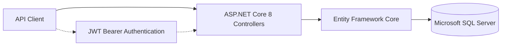
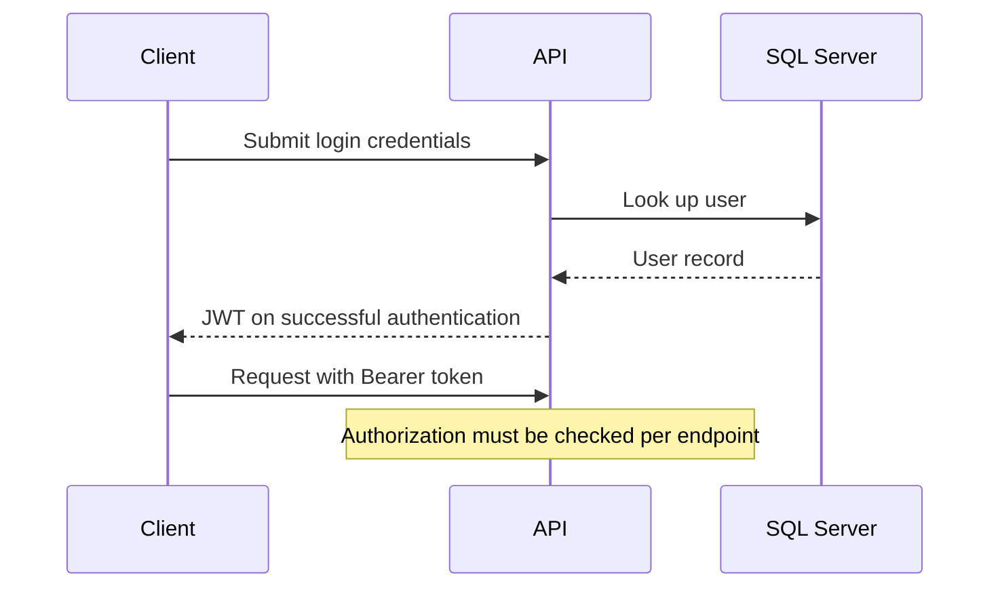

# API_net8 — JWT Authentication & Business REST API

**ASP.NET Core 8 · C# · JWT Bearer · Entity Framework Core · SQL Server**


> **ตัวอย่าง REST API ด้วย .NET 8** สำหรับการเข้าสู่ระบบด้วย JWT การจัดการผู้ใช้งาน และการเชื่อมต่อ Microsoft SQL Server

A backend code sample exploring **JWT authentication**, **CRUD endpoints**, and **SQL Server integration** for internal business applications.

**Project status:** Development / portfolio sample. Passing build, automated tests, production deployment, and security audit have **not** been independently verified.

---

## Features / ความสามารถในโค้ด

| Component | Description |
| --- | --- |
| **User management** | Login and user CRUD actions in `UsersController.cs` |
| **Authentication** | JWT token creation and JWT bearer validation |
| **Customer balances** | Sample API operations in `BalanceCustomersController.cs` |
| **Inventory balances** | Sample API operations in `BalanceInventoriesController.cs` |
| **Database** | Entity Framework Core with Microsoft SQL Server |
| **Developer documentation** | Swagger / OpenAPI configured for development |

**Security note:** JWT middleware does not automatically protect every endpoint. Each route must be reviewed for appropriate authorization policies; the customer and inventory controllers require particular attention.

## Architecture



*Conceptual overview of source components; not a verified production topology.*

## Technology stack

| Layer | Technology |
| --- | --- |
| API framework | ASP.NET Core 8 Web API / C# |
| Authentication | JWT bearer authentication |
| Data access | Entity Framework Core 8 |
| Database | Microsoft SQL Server |
| API documentation | Swashbuckle / Swagger |

## Repository structure

```text
API_net8/
├── Controllers/
│   ├── UsersController.cs
│   ├── BalanceCustomersController.cs
│   ├── BalanceInventoriesController.cs
│   └── WeatherForecastController.cs
├── Data/
│   └── DPowerAPIContext.cs
├── models/
├── Program.cs
├── DPowerAPI.csproj
├── DPowerAPI.sln
└── README.md
```

## Development setup

**Prerequisites:** .NET 8 SDK, a *separate development* SQL Server database and schema, and your own private development credentials and JWT signing key.

```bash
git clone https://github.com/pongapla/API_net8.git
cd API_net8
dotnet restore DPowerAPI.csproj
dotnet build DPowerAPI.csproj
dotnet run --project DPowerAPI.csproj
```

The database schema and environment-specific settings must be configured for your own environment. Swagger is registered in the project for development-time exploration. These instructions **have not been executed as part of this README update**.

## Authentication flow



## Security and maintenance considerations

- This GitHub repository is **public**, even if the actual application operates only on an internal company network.
- The committed `appsettings.json` contains a JWT signing key and SQL Server connection configuration. **Never reuse these values for new installations.** If they are still active, rotate affected secrets and remove sensitive values from the repository and its history.
- Enforce authorization on all protected API routes, independently of the frontend or internal-network restrictions.
- Review password verification, token expiry, error handling, logging, and package updates.
- Run automated tests and security checks before real deployment.

---

### Portfolio focus

**ASP.NET Core Web API · JWT authentication concepts · SQL Server · Business-oriented REST endpoints**

Developer: [Kittiphob Maynok](https://github.com/pongapla)
